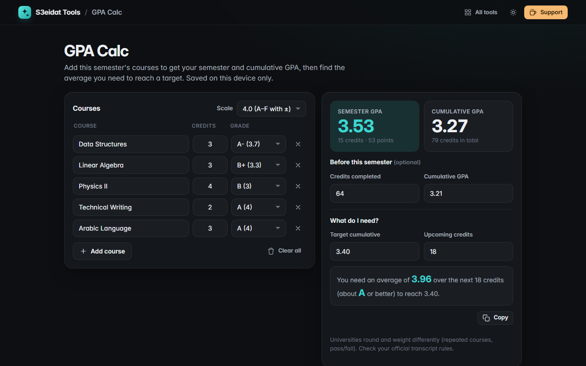

# GPA Calc

> Semester and cumulative GPA for students, with a what-do-I-need target calculator. Free, private, and it runs entirely in your browser.

### ▶ [Open GPA Calc](https://s3eidat.github.io/gpa-calc/)



## Features

- Courses with **credit hours** and **grades**; add or remove as many as you like
- Scales: **4.0** (A–F with + and −), **4.3** (A+ = 4.3), **5.0** (A+ = 5, F = 1) and **percentage** marks with a configurable range (e.g. 35–100, common at Jordanian universities)
- **Semester GPA** and **cumulative GPA** using your previous credits and GPA
- **What do I need?** The average (and the letter grade) you need over your upcoming credits to reach a target, or a clear 'not reachable'
- Everything is **saved on this device** automatically; copy a summary

Universities differ on rounding, repeated courses and pass/fail credits, so check your official transcript rules.

## Privacy

Your grades never leave your device; they are saved only in this browser's local storage. There is no server, no account, no analytics.
The page ships with a strict Content-Security-Policy (`connect-src 'self'`), so the browser
itself blocks any attempt to send data anywhere.

## Run it yourself

It's plain HTML, CSS and JavaScript with no build step:

```bash
git clone https://github.com/s3eidat/gpa-calc
cd gpa-calc
python -m http.server 8000
```

Then open http://localhost:8000.

## Support

If this saved you time, **[buy me a coffee ☕](https://s3eidat.github.io/coffee/)**. It keeps every tool free.

---

Part of **[S3eidat Tools](https://s3eidat.github.io/)**: 100+ free, private tools that run in your browser. MIT licensed.
